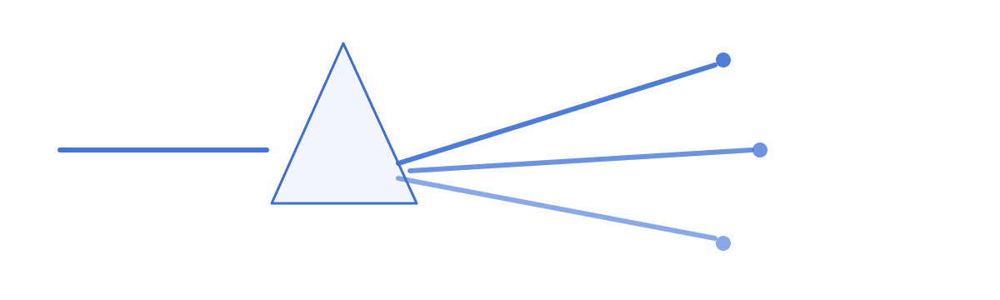

<p align="center">
  
</p>

<h1 align="center">DSH 探索 · DSH Explore</h1>

<p align="center">
  把一条对话摊成一张能自己长枝的画布。
  <br />
  A branching-conversation canvas for <b>DeepSeek Harness</b>.
</p>

<p align="center">
  
  
</p>

---

## 这是什么

DSH 里的对话是一条线：A → B → C。但真实的思考不长这样——同一个回答上，人往往同时想问好几件互不相干的事，问完之后又都压在历史里，没法并排看。

DSH 探索在你的会话里加一个 **「无限探索」** 页签：把这一轮轮问答铺到一张无限画布上，**任意一个回答都可以成为新的分岔口**。从某个节点再问一句，就长出一根新枝，它带着从根到这里的完整上下文继续往下走，枝条之间互不污染。

## 功能

- **无限画布** —— 拖拽平移、滚轮缩放（10%–200%）、适应画布，右下角小地图可点击跳转并显示当前视口。
- **任意回答开新枝** —— 卡片右上角的 `+` 就是追问入口，就地长出一张输入卡，回车发送后新节点立刻出现。
- **并行分支** —— 几条枝可以同时跑。正在回答的卡片带实时进度行：转圈指示器 +「正在思考… / 正在调用 read / 正在输出…」+ 第 N 步 + 已用秒数，正文按流式 token 边写边渲染，并带「停止」。
- **定位最新** —— 一键展开到最新节点的祖先路径并把那张卡片居中；最新按创建时间判定，并行完成顺序打乱也不会跳错。
- **折叠与搜索** —— 第三层起默认折叠；`Ctrl/Cmd+F` 聚焦搜索框，回车逐个跳转命中节点并自动展开祖先路径。
- **全屏阅读** —— 点卡片正文打开阅读层（Esc / 点背景 / × 关闭），长回答不用挤在 320px 里。
- **删除与恢复** —— 删除只写墓碑并归档对应的 fork 会话，工具栏可一键恢复；会话日志本身从不改写。

## 安装

前置：**DeepSeek Harness**（桌面版或 Web 版），且 profile 允许安装本地插件。

```bash
git clone https://github.com/tzzs/dsh-explore.git
```

然后在 DSH 里用插件管理把**这个目录的绝对路径**作为安装目标：

1. 打开插件管理（`plugin_manager`）→ `install_bundle`；
2. `target` 填克隆出来的目录，例如 `E:\workspaces\dsh-explore`；
3. 安装完成后，会话页签里会多出「无限探索」。

> 包名仍是 `@local/tree-conversations`。它是安装标识，不是展示名——改它会让已有安装失联，所以保留。展示名来自 `locale/`：中文「DSH 探索」、英文「DSH Explore」。

## 目录结构

```
client.js                客户端视图：事件投影、布局、画布、卡片、阅读层
index.js                 宿主侧空实现（这个插件只在客户端做事）
cordis.patch.yml         向 profile 插入一行 tree-conversations
locale/zh.json           中文展示名与描述
locale/en.json           英文展示名与描述
icon.svg                 插件图标
assets/hero.svg          README 头图（一条线分出多条路径）
test/render-smoke.cjs    渲染冒烟测试（假 React + 假 DOM，无需浏览器）
docs/design.md           设计文档：数据模型、取舍、已知缺口
```

## 实现要点

- **注册点**：`conversation.view`，`id: tree`、`order: 5`、`label: 无限探索`，与 Chat / Trajectory 并列。
- **节点是日志的投影**：读取会话的 `entries`（持久事件 + 暂态 `assistant/live-chunk`），把一个 turn 投影成一张卡片；不额外写记录，所以在 Chat 里继续聊，树上就会自然长节点。
- **分叉是真实会话**：`ctx.sessions.fork({ sessionId, atSeq })`，子会话天然继承到该回答为止的前缀上下文；每根枝会出现在会话列表里，插件会把它改名成 `⟂ 父问题 · 新问题` 便于辨认。
- **父子关系存在本地**：这一版 fork 不记录 `parentSession`，树形关系由插件在 `localStorage` 里维护（同时缓存折叠状态、墓碑、卡片高度）。
- **主题**：颜色全部使用 `--dsw-alias-*` CSS 变量，浅色 / 深色主题自动跟随，不写死色值。

## 开发

```bash
node --check client.js        # 语法
node test/render-smoke.cjs    # 渲染冒烟：把整个视图真渲染一遍并断言关键 UI 文本
```

`client.js` 是客户端插件（`window.__ModuleLoader__.load` 的惰性工厂），改完客户端热更新立即生效。注意样式表在每次 `apply()` 都会重写同一个 `<style>` 节点——如果只在节点已存在时跳过，热更新后的新规则永远不会生效。

## 已知限制

- **树关系只在这台机器的这个浏览器里**：换浏览器、清站点数据或换 profile，树枝会平掉（每个会话自己那条链还在，但接不回同一棵树）。
- **树是会话级的**：没有「把几棵树摆在一起」的本子。
- **视口之外的状态**：审批、提问、出错只体现在卡片状态和工具条的运行计数上，卡片不在视口时不会主动冒出来。
- **插件之外的 fork**：在 DSH 里、插件之外 fork 出来的会话识别不到，会被当成新树的根。

## License

[MIT](LICENSE) © 2026 tzzs

---

## English

**DSH Explore**（DSH 探索）adds an **Infinite exploration** tab to every DeepSeek Harness conversation: it lays the turns out on an infinite canvas where **any answer can become a fork point**. Ask a follow-up there and a new branch grows, carrying the full prefix context of the path that led to it, without contaminating its siblings.

- Infinite pan/zoom canvas with a clickable minimap that also shows the current viewport.
- `+` on any finished answer opens an inline composer; the new node appears immediately.
- Several branches run concurrently, each with a live progress row (thinking / tool name / step / elapsed) and a stop button; streamed tokens render as Markdown while they arrive.
- **Jump to latest** expands the ancestor path and centres the newest node; newest is judged by creation time, so out-of-order completions cannot send you to a stale card.
- Depth-3 branches start folded; `Ctrl/Cmd+F` searches nodes and reveals the ancestor path.
- Click the answer body for a full-screen reader; deleting is a tombstone plus archiving the fork's session, and it is reversible.

**Install** — clone this repo, then point DSH's plugin manager at the absolute directory (`install_bundle`, `target = <clone path>`). The tab shows up as「无限探索」.

**Tech** — `client.js` registers `conversation.view` (`id: tree`); nodes are projections of session events (`entries`, including transient `assistant/live-chunk`); forks are real sessions created with `ctx.sessions.fork({ sessionId, atSeq })`; parent links live in `localStorage` because this DSH build does not record `parentSession`; all colours use `--dsw-alias-*` theme tokens.

**Limits** — the tree relationship is local to this browser; there is no cross-session notebook; approvals/questions outside the viewport do not surface; sessions forked outside the plugin cannot be attached to a tree.

Licensed under [MIT](LICENSE).
