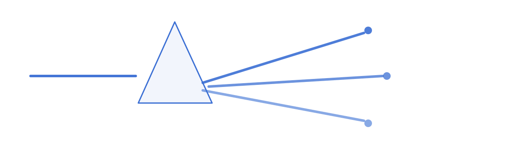

<p align="center">
  
</p>

<h1 align="center">DSH Explore</h1>

<p align="center">
  A branching-conversation canvas for <b>DeepSeek Harness</b>.
</p>

[](https://github.com/tzzs/dsh-explore/actions/workflows/ci.yml)
[](https://github.com/tzzs/dsh-explore/releases)
[](LICENSE)


**English** | [简体中文](README.zh-CN.md)

---

## What it is

A conversation in DSH is a line: A → B → C. Real thinking does not look like that — on one answer you often want to ask several unrelated things at once, and once asked they all sink into history with no way to put them side by side.

DSH Explore adds an **Infinite Exploration** tab to every conversation: it lays the turns out on an infinite canvas where **any answer can become a fork point**. Ask a follow-up on a node and a new branch grows from it, carrying the full context from the root to that node while leaving its siblings untouched.

A branch is not a prompt with history pasted into it. It is a real DSH session created with `ctx.sessions.fork({ sessionId, atSeq })`, so it inherits the exact event prefix up to that answer; tools, approvals, streaming, cancellation and retries all behave like any other conversation.

## Features

- **Infinite canvas** — drag to pan, scroll to zoom (20%–200%), fit to canvas; the minimap in the bottom-right corner shows the current viewport and jumps on click. On supported DSH layouts, the canvas extends behind the title and composer.
- **Both tree directions** — the toolbar carries a two-way layout switch: **top to bottom** or **left to right**. Both options are visible at once and the active one is pressed, so the current direction never has to be guessed from the shape of the canvas. The choice is saved in this browser and applies to other conversations.
- **Adjustable card density** — the toolbar offers three card presets: compact (288px), standard (320px) and roomy (448px). A preset sets both the card width and how many lines of the answer a preview draws; the tree reflows to the chosen width and the choice is remembered. Switch to roomy when the cards feel too small to show a useful answer.
- **Host appearance** — the interface follows DSH in eight languages (Chinese, English, German, Spanish, French, Japanese, Portuguese, Russian) and in both the light and the dark theme: elevation, overlay surfaces, scrollbars and native form controls are all theme-aware.
- **Fork from any answer** — the `+` in the corner of a finished card opens an inline composer; press Enter and the new node appears immediately.
- **Concurrent branches** — several branches can run at once. A running card carries a live progress row (spinner, "Thinking… / Calling read / Writing…", step N, elapsed seconds), renders streamed tokens as Markdown while they arrive, and offers Stop.
- **You can see what it is thinking** — an elapsed time says the agent is busy, not what it is doing. A running card carries one line of the model's newest thinking; settled, that line becomes "Reasoning · N chars". It is a readout, not a button: the card has exactly one way to enlarge ("Read full screen"), and the reader switches between the final answer and the reasoning inside the same card. The line is always one line, so the card does not move while tokens stream. A model that does not think shows none of this.
- **Waiting on you** — a branch parked on a question or an approval says so on its card ("Waiting for your answer…" / "Waiting for your approval…") with an accent ring; the canvas expands the path to it and centres it, and the toolbar chip "N waiting on you" jumps there. The path to a running or waiting node is never hidden by the default fold.
- **Jump to latest** — expands the ancestor path of the newest node and centres that card; newest is judged by creation time, so out-of-order completions cannot send you to a stale card.
- **Fold and search** — branches at depth 3 and deeper start folded, except on the path to a running or waiting node; `Ctrl/Cmd+F` focuses the search box, and Enter steps through matches, revealing their ancestor paths.
- **The card previews, the reader reads** — the card keeps the answer to a fixed number of lines with a fade, and there is no in-card "expand answer" any more: expanding there turned the card into a very long strip. The answer, the progress row and the thinking line share one content window: while a branch runs the window has a fixed height, and it settles to its content afterwards, so the canvas does not shake when several branches stream at once. The "Read full screen" button at the bottom is the card's only way in: Esc, the backdrop, or × closes the reader, and the reader itself switches between the final answer and the reasoning, and between a standard and a wider measure.
- **Branch rows stay out of the workspace** — every new branch is a real session, so DSH lists it as its own row by default. One toolbar chip switches the tree between "Branch rows: in workspace" and "Branch rows: archived" (listed by default; one click archives what already finished and new finished branches follow): archiving moves this tree's finished branch sessions into DSH's archive (the canvas still reads them; the workspace keeps the main session), and switching back restores them. Only finished branches are archived — a running or waiting branch always stays promptable.
- **Delete and restore** — deleting writes a tombstone and archives the fork's session; the toolbar restores them in one click. The session log itself is never rewritten. A branch the row policy quieted is not owned by that restore: the tombstone brings the node back on the canvas, and switching the branch rows back to the workspace brings its session back to the list.

## Requirements

- **DeepSeek Harness**, desktop or web, on a profile that allows installing plugins.
- **Node.js 22+** — development only. The plugin has no build step and no npm dependencies of its own.

## Install

The plugin is published to npm as `@tanzz/dsh-explore`. Install it through DSH's plugin manager:

1. Open the plugin manager (`plugin_manager`) → `install_bundle`.
2. Set `target` to `@tanzz/dsh-explore`; pin a version with `@tanzz/dsh-explore@0.1.0`.
3. When it finishes, the conversation tabs include 「无限探索」 / Infinite Exploration.

> The package name is an install identifier, not a display name: the display name comes from `locale/` — 「DSH 探索」 in Chinese, DSH Explore in English. npm's unscoped `dsh-explore` is taken by an unrelated project, so the package lives under the user scope.

To work on the plugin itself, install the clone instead — the profile records it as a `link:` dependency, and edits hot-swap:

```bash
git clone https://github.com/tzzs/dsh-explore.git
# target: the absolute path, e.g. E:\workspaces\dsh-explore
```

To install a specific release without npm, download the `.tgz` attached to that GitHub Release and point `install_bundle` at the unpacked `package` directory:

```bash
mkdir dsh-explore-release
tar -xzf tanzz-dsh-explore-0.1.0.tgz -C dsh-explore-release
# target: <absolute path>/dsh-explore-release/package
```

## Naming

Four layers, four jobs, deliberately not collapsed into one name:

| Layer | Name | Where it appears | Why this one |
|---|---|---|---|
| Repository | `dsh-explore` | GitHub URL, `git clone` | the public address; short, lowercase, no spaces, and it does not change after release |
| Package | `@tanzz/dsh-explore` | `package.json`, npm registry, the profile's dependency | matches the repo, so an install is easy to trace; npm's unscoped `dsh-explore` is taken, so it uses the user scope; renaming it means uninstall and reinstall |
| Plugin (display name) | DSH Explore / 「DSH 探索」 | plugin list, settings page | the product name a human reads; the `DSH` prefix says which host it belongs to |
| View (tab) | Infinite Exploration / 「无限探索」 | the third tab inside a conversation | describes what the view does, not the product; follows the UI language |

The tab is a **view name**, so it is not folded into the display name — "DSH Infinite Exploration" would collide with the tab and read badly in both languages. Nor is the tab shortened to `Explore`: that drops the "infinite" part, and the canvas really does extend without bound.

## Project layout

```
client.js                        client view: event projection, layout, canvas, cards, reader overlay
index.js                         host half, an empty apply() — all the work happens in the client
cordis.patch.yml                 inserts the dsh-explore row into the DSH profile
locale/zh.json                   Chinese display name and description
locale/en.json                   English display name and description
icon.svg                         plugin icon
assets/hero.svg                  README hero: one line branching into several paths
test/render-smoke.cjs            renders the whole view with a fake React and asserts both language tables
test/canvas-visibility.cjs       running/waiting nodes must be laid out and drawn; waiting copy; projection whitelist
test/session-rebind.cjs          re-subscribe on a new eventSource, no pruning on an empty window, cold session open()
test/theme-tokens.cjs            no literal colours, required tokens exist, inverted primary-button foreground
test/motion.cjs                  camera interpolation, gesture interruption, navigation replacement, reduced motion
test/wheel-scroll.cjs            the canvas yields the wheel to inner scroll areas and stops at their ends
test/live-clock.cjs              the running card counts wall clock, and only one timer exists
test/reader-dialog.cjs           the reader is a native modal: no hand-built focus trap, contained scroll
test/card-display.cjs            three card densities, no in-card expand, reader width presets and geometry
test/card-reading.cjs            a card that does not move while it streams, one enlarge entry, two reader panes
test/branch-sessions.cjs         branch archive policy: finished only, switchable, unarchived around a fork
test/branch-archive-flow.cjs     archive flow end to end: only after the turn, both switch directions, tombstone isolation
test/markdown-table.cjs          GFM tables: alignment, escaped pipes, scrollable wrapper
test/markdown.cjs                the whole supported Markdown surface, plus what it refuses
test/layout-direction.cjs        horizontal and vertical geometry, unequal heights, collapsed branches
test/host-overlay.cjs            conversation overlay, chrome measurement, reader and fallback
test/locale-parity.cjs           all eight dictionaries: same key set, aligned {placeholders}, no cross-script leakage
test/reasoning.cjs               the reasoning card: live line, reader panes, no-reasoning, retry, cap, truthful count
test/reasoning-persist.cjs       reasoning stays out of the snapshot and is re-derived after a reload
test/real-log.cjs                end-to-end harness over a real session.v4.jsonl.zstd
docs/design.md                   design doc: data model, trade-offs, known gaps
docs/releasing.md                CI, Release Please and npm publishing
.github/workflows/               CI, Release Please and the manual npm publish workflow
```

## How it works

The view is a single client plugin; the full design — data model, trade-offs, known gaps — is in [docs/design.md](docs/design.md) (currently in Chinese).

- **Registration.** One `conversation.view` slot: `id: 'tree'`, `order: 5`, and a `label` thunk that is re-evaluated on every projection, next to Chat and Trajectory.
- **Copy follows the host language.** Every visible string is a key in the `dsh-explore` namespace resolved through the client locale service, so switching language swaps the tab title and the whole view. A profile without the locale plugin falls back to the built-in Chinese/English tables, chosen by `document.documentElement.lang`.
- **Nodes are projections.** The view reads a session's `entries` (durable events plus the transient `assistant/live-chunk`) and projects one turn onto one card. Nothing extra is recorded, so continuing the chat in Chat simply grows the tree.
- **"Waiting on you" has no event of its own.** In the host, `ask_user_question` and approvals are just "a tool that has not returned yet": no `turn/end` is emitted while waiting and `running` stays `true`. The plugin derives the state from `tool/call` (`ask_user_question`, settled by `callId` in `tool/result`) and `approval/asked → approval/decided`, and relabels the card from calling a tool to waiting. `user/message` only ever carries `source.kind: 'user'` or `'user-question-reply'`, and both are projected.
- **Reasoning is visible, and it is already in the event window.** The model writes its thinking as `reasoning` content blocks — live as a `reasoning-delta` chunk on the transient `assistant/live-chunk`, settled as `{ type: 'reasoning', text }` inside the durable `assistant/message`. Both reach the plugin unchanged, so one projection covers "thinking now" and "done thinking": while a branch runs the card shows the newest line, and once it settles that line becomes the character count; the whole chain is one deliberate switch away in the reader. A model that does not think renders nothing. A retry reuses the same turn/step, so the failed attempt's thinking is dropped first. Each card keeps at most 12000 characters, and the dropped count is derived from the bytes each block delivered (`received − kept`) rather than accumulated, because a block is trimmed more than once. Reasoning is **not** persisted to `localStorage`: it is re-derived from the log, and that snapshot also holds the parent links, which cannot be rebuilt.
- **The path to an active node is never folded.** Layout only walks unfolded nodes, and a folded node has no position and is never drawn — that was the root cause of "the canvas does not show the node that is running". So the ancestor path of a running or waiting node skips the default fold; a node entering the running state also expands and persists that path, and a node that starts waiting moves the canvas onto itself. The toolbar's running count and "waiting on you" count are both jump buttons.
- **Sessions get re-bound.** Leaving a conversation drops the host's reference; at zero the scope is collected and the `Session` instance is discarded together with its event window. On the way back, `materializeScope` mints a new `eventSource` and the window starts empty. Subscriptions therefore follow `eventSource` (the old one unsubscribes), an empty window is never treated as "the session is empty" and pruned, and a cold session is `open()`ed once — otherwise returning straight to the tab gives a blank canvas while Chat-then-tab works. `test/session-rebind.cjs` pins this.
- **Forks are real sessions.** `ctx.sessions.fork({ sessionId, atSeq })` gives the child the prefix context up to that answer. Each branch also lands in the session list, so it is renamed `⟂ parent question · new question` to stay recognisable. A client plugin cannot make that row a nested "subtask" — only host subagent sessions get hidden/nested rows — so the tree offers the one supported lever: a finished branch can be archived (readable, no longer listed, no longer promptable) and the toolbar switches the whole tree between listed and archived. `quieted` is tracked separately from the deletion tombstones so restoring a deleted node never surfaces a branch the policy quieted.
- **Parent links live locally.** This DSH build does not record `parentSession`, so the plugin keeps the tree in `localStorage`, alongside fold state, tombstones and the layout preference. Card heights are measured at runtime.
- **Theme.** All colours are `--dsw-alias-*` variables, so light and dark follow the host and no literal value is written. `--dsw-alias-brand-primary` inverts between themes, so primary-button text must use the matching `--dsw-alias-label-primary-foreground` rather than `#fff`; inline code is tinted with 7% `label-primary` because the official inline-code token is nearly white in light mode. Fonts read the composed `--dsw-font-family` / `--ds-font-family-code` tokens, which already join the user's font with the built-in fallback stack. `test/theme-tokens.cjs` guards all of it.

## Development

```bash
npm test                      # all nineteen commands below (scripts.test in package.json)

node --check client.js        # syntax
node test/render-smoke.cjs    # render the whole view with a fake React; assert both language tables
node test/canvas-visibility.cjs  # running/waiting nodes must be laid out and drawn; waiting copy; projection whitelist
node test/session-rebind.cjs  # re-subscribe after a scope rebuild; no pruning on an empty window; cold session open()
node test/theme-tokens.cjs    # no literal colours, tokens exist, primary buttons use the inverted foreground
node test/motion.cjs          # camera moves, gesture interruption, navigation replacement, reduced motion, cleanup
node test/wheel-scroll.cjs    # the wheel belongs to the reasoning box, not the canvas zoom
node test/live-clock.cjs      # the elapsed time advances between events, from one timer
node test/reader-dialog.cjs   # the reader is a native <dialog>: showModal, close mirroring, backdrop scroll containment
node test/card-display.cjs    # three card densities, no in-card expand, reader width presets and reflow geometry
node test/card-reading.cjs    # a card that does not move while it streams, one enlarge entry, two reader panes
node test/branch-sessions.cjs # finished branches only, switchable policy, unarchived around a fork
node test/branch-archive-flow.cjs # archive flow end to end: only after the turn, both directions, tombstone isolation
node test/markdown-table.cjs  # GFM tables in answers
node test/markdown.cjs        # every Markdown construct the renderer supports
node test/layout-direction.cjs # geometry in both directions, unequal heights, collapsed branches
node test/host-overlay.cjs     # host overlay, chrome measurement, reader, fallback
node test/locale-parity.cjs   # all eight dictionaries agree on keys, placeholders and script
node test/reasoning.cjs       # reasoning: live line, reader panes, no-reasoning, retry, cap, truthful count
node test/reasoning-persist.cjs  # reasoning stays out of the snapshot; re-derived after reload; parent links survive
```

`node test/real-log.cjs <a session.v4.jsonl.zstd>` replays a real session end to end; it is optional and not part of `npm test`.

`client.js` is a client plugin — the lazy factory behind `window.__ModuleLoader__.load` — and edits hot-swap into the running host without a page reload. Note that the stylesheet rewrites the same `<style>` node on every `apply()`: skipping the rewrite when the node already exists means new rules never take effect after a hot reload.

## CI & releases

A PR to `main` runs `.github/workflows/ci.yml` on Ubuntu and Windows with Node.js 22 and 24: `node --check index.js`, `npm test`, `npm pack --dry-run`. There is no install step — the plugin and its tests have no npm dependencies, and there is no lockfile.

Releases are driven by Conventional Commits through Google's Release Please: it opens or updates a release PR that bumps `package.json`, the manifest and `CHANGELOG.md`; merging it starts the release job, which runs the full matrix on the released commit, packs `tanzz-dsh-explore-<version>.tgz`, attaches it to the GitHub Release, publishes the release, lets GitHub create the `v<version>` tag, and publishes the same commit to npm with provenance. `@tanzz/dsh-explore@0.1.0` is the published baseline; later versions publish automatically from that workflow.

See [CI and releases](docs/releasing.md) (currently in Chinese) for first-time setup — Actions permissions, the optional `RELEASE_PLEASE_TOKEN` secret, and npm Trusted Publishing.

## Contributing

See [CONTRIBUTING.md](CONTRIBUTING.md). Commit messages and PR titles follow [Conventional Commits](https://www.conventionalcommits.org/) — Release Please derives the next version from them — and bug reports and feature requests have issue templates.

## Security

See [SECURITY.md](SECURITY.md) for how to report a vulnerability privately. Please do not open a public issue for one.

## Limitations

- **The tree relationship lives in this browser on this machine.** Another browser, cleared site data or another profile flattens the tree: each session keeps its own chain, but the branches cannot be reattached.
- **A tree is per session.** There is no notebook that puts several trees side by side.
- **Errors stay on the card.** A failed turn shows its state there and does not pull the canvas over to itself; questions and approvals do.
- **Forks made outside the plugin are invisible.** A session forked in DSH by other means is opened as the root of a new tree.

## License

[MIT](LICENSE) © 2026 tzzs

[MIT](LICENSE) © 2026 tzzs

By participating you agree to the [Code of Conduct](CODE_OF_CONDUCT.md).
